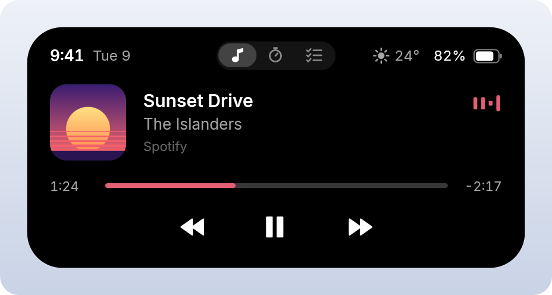
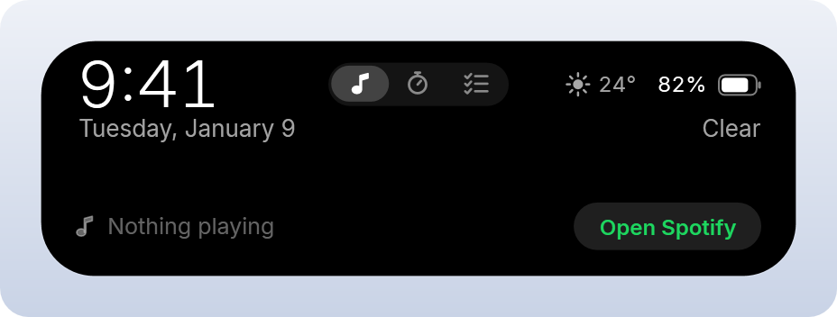

<div align="center">

# Dynamic Island for Windows

**A lightweight, native take on the iPhone's Dynamic Island for Windows 10 and 11.**<br>
Now playing, volume, battery and the time, in a little black island at the top of your screen.




</div>

## What it does

The island sits at the top center of your main screen and changes shape depending on what's going on.

| State | When | What you see |
|---|---|---|
| **Dot** | nothing is happening | a small black circle |
| **Pill** | something is happening | now playing · volume change · charger plugged in |
| **Expanded** | you hover over or click it | clock, date, battery, weather and full media controls |

<table>
  <tr>
    <td align="center"><br><sub>Now playing</sub></td>
    <td align="center"><br><sub>Volume changed</sub></td>
  </tr>
  <tr>
    <td align="center"><br><sub>Charger connected</sub></td>
    <td align="center"><br><sub>Expanded, nothing playing</sub></td>
  </tr>
</table>

## Features

- **Now playing, for any app.** Spotify, YouTube in your browser, and any other player that shows up in the
  Windows media controls (the media card you see when you press a volume key). You get album art, title,
  artist, progress and ⏮ ⏯ ⏭, plus an equalizer tinted with the album's colour. When several apps play,
  Spotify wins; you can also limit it to Spotify only.
- **Volume indicator.** Pops up whenever the volume or mute changes, whether from keyboard keys, the Windows
  flyout or any app. It follows you when you switch to headphones or Bluetooth.
- **Battery.** Shows the percentage and charging state, and a "Charging" pill appears when you plug in.
  The battery is green while charging, red at 20 % and below, and yellow in Battery Saver. Hidden on desktop PCs.
- **Clock and date.** Follows your Windows 12/24-hour and date format.
- **Weather (optional).** Free data from [Open-Meteo](https://open-meteo.com), no API key needed. Off by default.
- **Stays out of your way.**
  - Click-through everywhere except the island itself.
  - Never steals keyboard focus.
  - Hidden from Alt+Tab and the taskbar.
  - Fades out while a fullscreen game, video or presentation is in front.
- **Smooth, iOS-like motion.** Spring animations with a little overshoot, and corners that morph with the shape.
- **Light on resources.** About 3 MB in Task Manager when idle, fully event-driven, and zero NuGet packages.
- **Start with Windows** from the right-click menu.

## Requirements

- Windows 10 version 1809 or later, or Windows 11 (64-bit)
- To build it: the .NET 10 SDK, or Visual Studio 2026 with the **.NET desktop development** workload

## Install

### Download

Get the latest version from the [Releases](../../releases) page. There are two zips with the same app inside:

| Download | Size | Needs |
|---|---|---|
| `DynamicIsland-…-win-x64.zip` | ~7 MB | The free [.NET 10 Desktop Runtime](https://dotnet.microsoft.com/download/dotnet/10.0). If it's missing, Windows offers to install it on the first launch |
| `DynamicIsland-…-win-x64-standalone.zip` | ~76 MB | Nothing: .NET is included |

1. Unzip it anywhere, for example `C:\Apps\DynamicIsland`.
2. Run `DynamicIsland.exe`.
3. Right-click the island and choose **Start with Windows**.

If you move the folder later, run the exe from its new location and turn **Start with Windows** on again.

### Build from source

**Visual Studio**

1. Install [Visual Studio 2026](https://visualstudio.microsoft.com/) (the Community edition is free) with the
   **.NET desktop development** workload.
2. Clone this repository and open `DynamicIsland.sln`.
3. Set the configuration to **Release** and press **Ctrl+F5**.

**Command line** (needs the [.NET 10 SDK](https://dotnet.microsoft.com/download/dotnet/10.0)), from the cloned folder:

```powershell
dotnet run -c Release
```

**Release builds**, the same two single-exe builds as on the Releases page:

```powershell
# Small: needs the .NET 10 Desktop Runtime on the target PC
dotnet publish -c Release -r win-x64 --self-contained false -p:PublishSingleFile=true -o publish\small

# Standalone: .NET included, nothing to install
dotnet publish -c Release -r win-x64 --self-contained true -p:PublishSingleFile=true -p:IncludeNativeLibrariesForSelfExtract=true -p:PublishReadyToRun=true -o publish\standalone
```

> Don't add `PublishReadyToRun` to the small build: in testing, ReadyToRun combined with a framework-dependent
> single-file build crashed at startup.

> The code uses nothing specific to .NET 10. To build on an older SDK, change `net10.0` to `net8.0` in
> `DynamicIsland.csproj`.

## Usage

| Do this | To get this |
|---|---|
| Hover over the island (about 0.2 s) | It expands; move away and it collapses |
| Click the island | Expand or collapse (handy on touch screens) |
| Click the album art | Brings Spotify to the front |
| Right-click the island | Menu: **Start with Windows** (on/off) · **Exit Dynamic Island** |

"Start with Windows" adds a per-user startup entry (no admin rights needed). You'll see it in
Task Manager → Startup apps.

## Configuration

Every setting lives in [`IslandConfig.cs`](IslandConfig.cs). Change a value and rebuild.

| Setting | Default | What it does |
|---|---|---|
| `DotSize`, `CompactWidth/Height`, `ExpandedWidth`, `Expanded…Height` | 14 · 300×36 · 420 × 200/132 | Size of each state, in DIPs |
| `TopMargin` | 6 | Gap between the top of the screen and the island |
| `HoverPadding` | 8 | Invisible margin around the island that makes the small dot easy to hover. Set to `0` so only the visible shape catches the mouse |
| `HoverExpandDelay` / `HoverCollapseDelay` | 160 / 320 ms | How long to hover before it expands, and how long it waits before collapsing |
| `MediaSource` | `PreferSpotify` | `PreferSpotify` (whatever is playing, Spotify first) · `SpotifyOnly` · `AnyApp` (Windows' current session) |
| `WeatherCity` | `""` (off) | A city (`"Jakarta"`) or coordinates (`"-6.2,106.8"`). While empty, the app makes **no network requests at all** |
| `UseFahrenheit` | `false` | °F instead of °C |
| `HideWhenFullscreen` | `true` | Fade out while a fullscreen app is in front |
| `UseSoftwareRendering` | `true` | Render on the CPU; uses much less memory than the GPU path (see below) |
| `TrimMemoryWhenIdle` | `true` | Return unused memory to Windows after startup and 30 s after each collapse |

## How it works

No NuGet packages are used; everything is built on APIs that ship with Windows:

| Part | Built on |
|---|---|
| Window | A transparent, topmost WPF window. Windows sends clicks on fully transparent pixels of a layered window to the app underneath, so only the island is clickable. `WS_EX_NOACTIVATE` and `WS_EX_TOOLWINDOW` keep it from taking focus and hide it from Alt+Tab. |
| Media | Windows' Global System Media Transport Controls (`Windows.Media.Control`). This is local and push-based, needs no Spotify developer account or login, and the controls work on free Spotify accounts too. |
| Volume | Core Audio (`IAudioEndpointVolume` plus device-change notifications), through a few lines of COM interop in [`Interop/CoreAudio.cs`](Interop/CoreAudio.cs). |
| Battery | `RegisterPowerSettingNotification`, so Windows notifies the app on every 1 % change and on plug/unplug. |
| Animation | A custom damped-spring easing ([`Helpers/SpringEase.cs`](Helpers/SpringEase.cs)) drives the size. The corner radius is bound to the height, so the shape morphs continuously. |
| Font | Apple's SF Pro if it is installed, otherwise the bundled **Inter**. SF Pro's licence doesn't allow it to be redistributed, so Inter, an open-source look-alike, ships in [`Fonts/`](Fonts). |

## Performance

Everything is event-driven:
- The only always-running timer fires once a minute, for the clock.
- The equalizer animates only while music is playing and visible, at 30 fps.
- Every timer, COM callback, WinRT event and power registration is released on exit.

Measured on Windows 11 at 125 % scaling:

| | Task Manager "Memory" | Committed memory |
|---|---|---|
| Just after start | ~23 MB | ~42 MB |
| Idle, after the automatic trim | **~3 MB** | ~44 MB |
| For comparison: same app with GPU rendering | ~80 MB at start | ~105 MB |

## Project structure

```
├─ App.xaml(.cs)              startup: single instance, render mode, crash logging
├─ MainWindow.xaml            layout, styles, icons, animations
├─ MainWindow.xaml.cs         state machine, morph animations, window plumbing, timers
├─ IslandConfig.cs            all settings
├─ Services/                  MediaService · AudioVolumeService · PowerService · WeatherService
├─ Interop/                   Win32 and Core Audio declarations
├─ Helpers/                   SpringEase · ColorExtractor · OneShotTimer · StartupManager · …
├─ Controls/BatteryIcon.cs    iOS-style battery glyph
├─ Fonts/                     Inter (SIL Open Font License)
└─ docs/screenshots/          images used in this README
```

## Troubleshooting

- **Spotify doesn't show up.** Use the Spotify desktop app or the Microsoft Store version. The web player
  shows up as your browser instead, which works too. If the Windows media card (press a volume key) shows
  your player, the island will too.
- **Starting it again does nothing.** Only one copy runs at a time. Look for the dot at the top center of
  your *main* monitor.
- **Something else is wrong.** Errors are written to `%LOCALAPPDATA%\DynamicIsland\log.txt`; include that
  file when you open an issue.

## Contributing

Issues and pull requests are welcome. Please keep the project lightweight and free of extra dependencies.

## License

[MIT](LICENSE). The bundled Inter font is licensed separately under the
[SIL Open Font License 1.1](Fonts/Inter-LICENSE.txt).

---

<sub>This is an independent project inspired by Apple's Dynamic Island. It is not affiliated with, endorsed
by or sponsored by Apple Inc. or Spotify AB. All trademarks belong to their respective owners.</sub>
